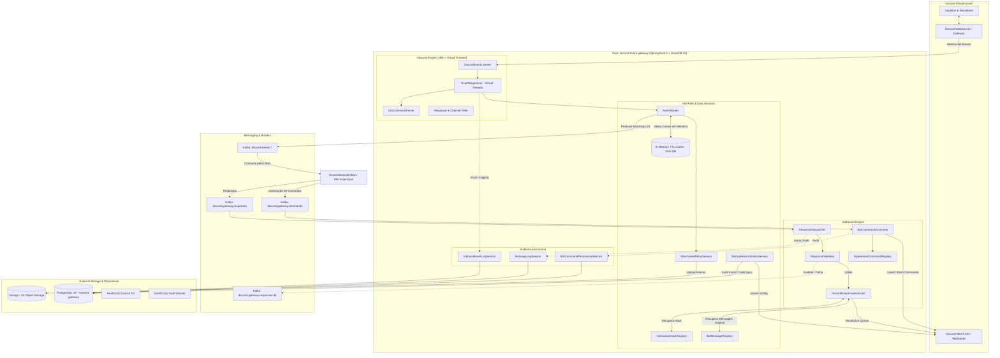
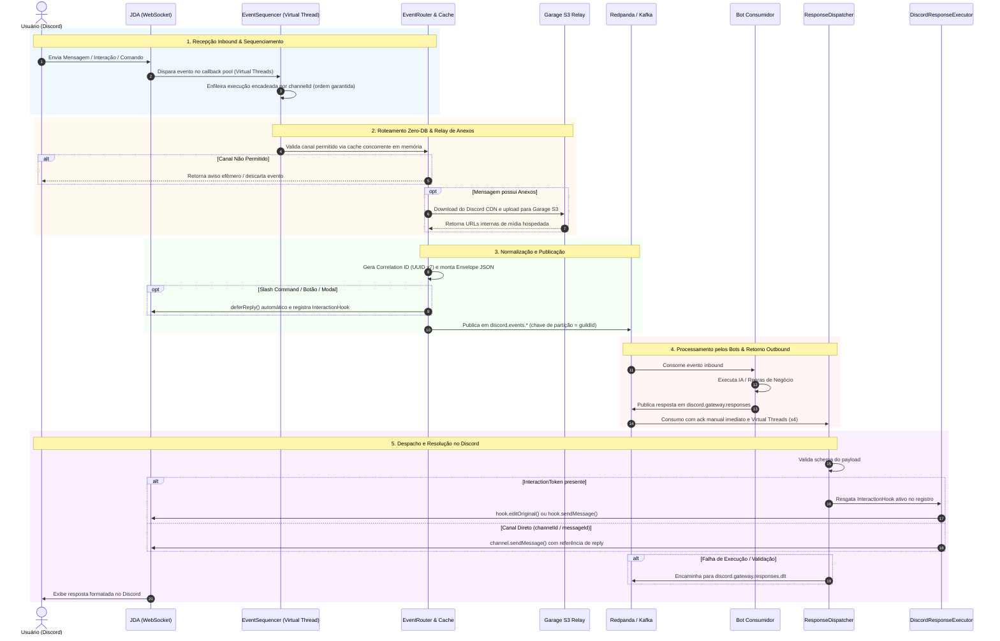

[](https://openjdk.org/)
[](https://www.graalvm.org/)
[](https://spring.io/projects/spring-boot)
[](https://github.com/discord-jda/JDA)
[](https://kafka.apache.org/)
[](https://www.postgresql.org/)
[](https://garagehq.deuxfleurs.fr/)
[](https://resilience4j.readme.io/)

O **Discord Event Gateway** é um serviço de infraestrutura de alto desempenho, reativo e orientado a eventos, projetado para servir como ponte bidirecional entre o Discord e ecossistemas de microsserviços. Construído sobre o **Java 25 com GraalVM** e **Spring Boot 4**, ele recebe eventos da API de Gateway do Discord via **JDA (Java Discord API)**, normaliza os payloads em envelopes padronizados JSON (com identificadores **UUID v7**) e os transmite com baixíssima latência para tópicos **Apache Kafka / Redpanda**.

De forma simétrica, o gateway consome intenções de resposta e registros de comandos emitidos por múltiplos bots consumidores, realizando o despacho concorrente de volta à API do Discord através de webhooks, canais diretos e comandos de barra (*slash commands*).

O sistema foi concebido para **altíssima concorrência**, throughput em rajada, isolamento por canal e suporte nativo a **GraalVM** (compilação *AOT Native Image* e *GraalVM JIT* com ZGC generacional).

---

## 🏛️ Arquitetura do Sistema

O gateway atua desacoplando totalmente a lógica de negócio dos bots da conexão persistente com o WebSocket do Discord. O pipeline conta com camadas de sequenciamento ordenado por canal, validação hot-path com zero consultas repetitivas a banco de dados e relay de anexos em storage S3.



---

## ⚡ Fluxo de Execução Ponta a Ponta

Cada evento de entrada e cada comando de resposta percorre um fluxo desacoplado, sem bloqueio de I/O de rede no loop principal:



---

## 🛠️ Destaques de Engenharia e Resiliência

### 1. Hot-Path Zero-DB & Caches Concorrentes em Memória
- **Zero Consultas SQL no Fluxo Crítico**: Configurações de guildas como `ALLOWED_CHANNELS` e flags como `ATTACHMENT_RELAY_ENABLED` são resolvidas diretamente de uma camada de cache concorrente thread-safe (`ConcurrentHashMap`) com expiração TTL (60s) e invalidação seletiva via `/config`.
- **Prevenção de Gargalo de Banco**: Nenhuma mensagem em chat gera leitura direta ao PostgreSQL no momento do roteamento.

### 2. Sequenciamento de Eventos por Canal (`EventSequencer`)
- **Preservação de Ordem por Canal**: Mensagens consecutivas no mesmo canal são encadeadas de forma assíncrona usando `CompletableFuture` com Virtual Threads, impedindo race conditions na ordem de processamento de comandos sem travar o processamento de outros canais ou guildas.
- **Isolamento de Erros**: Falhas de processamento em uma mensagem não propagam interrupção para as mensagens seguintes.

### 3. Relay de Anexos com Respeito a Boost Tiers (`AttachmentRelayService`)
- **Persistência Imediata de Mídias**: Anexos enviados por usuários no Discord CDN (que possuem links temporários assinados) são transferidos para buckets compatíveis com S3 (**Garage Storage**).
- **Validação de Tamanho por Nível de Servidor**: O tamanho dos arquivos é validado de acordo com o nível de Boost do servidor Discord (`BoostTier.getMaxFileSize()`), evitando estouro de buffer e downloads abusivos.

### 4. Gerenciamento Reativo de Slash Commands (`BotCommandConsumer`)
- **Sincronização Bidirecional**: Consome declarações de comandos do tópico `discord.gateway.commands` e os cadastra/remove globalmente ou por guilda na API do Discord através do JDA.
- **Suporte a Respostas Efêmeras Transparentes**: O `EphemeralCommandRegistry` memoriza quais comandos exigem respostas visíveis apenas para quem os executou, disparando o `deferReply(true)` de forma automática.

### 5. Dead Letter Topic (DLT) & Auditoria
- **Garantia contra Perda de Mensagens**: Respostas de bots com schema inválido ou rejeitadas pela API do Discord são encaminhadas ao tópico `discord.gateway.responses.dlt` com headers descritivos (`dlt-reason`, `dlt-detail`).
- **Auditoria Assíncrona Não-Bloqueante**: Histórico de mensagens recebidas, respostas despachadas e lifecycle das guildas são persistidos no PostgreSQL através de executores dedicados de Virtual Threads.

---

## ⚡ Runtime de Alta Performance com GraalVM e Java 25

A aplicação é preparada para compilação **AOT nativa** ou execução com o compilador **GraalVM JIT**:

```dockerfile
# Compilação Multi-Stage no Dockerfile
FROM ghcr.io/graalvm/native-image-community:25 AS native-builder
FROM debian:bookworm-slim AS native
```

### Otimizações Habilitadas no Dockerfile:
- **GraalVM Native Image & AOT**:
  - Binário executável C++ ultraleve (~60MB), inicialização em **< 50ms** e consumo de memória em repouso de apenas **~40MB RAM**.
  - Configurações centralizadas de reflexão em [`GraalVmHints.java`](file:///C:/Users/guilh/IdeaProjects/discord-gateway-api/src/main/java/com/discord/gateway/config/GraalVmHints.java) cobrindo DTOs, JPA e Jackson.
- **GraalVM JIT (JVMCI) com Generational ZGC**:
  - `-XX:+UnlockExperimentalVMOptions -XX:+EnableJVMCI -XX:+UseJVMCICompiler`: Ativa o compilador JIT Graal de alta taxa de throughput.
  - `-XX:+UseZGC -XX:+ZGenerational`: Coletor de lixo de pausa ultra-baixa (< 1ms), ideal para streams contínuos de eventos WebSocket e Kafka.
  - `-Djdk.graal.Vectorization=true`: Vetorização SIMD automática para aceleração de serialização JSON e manipulação de buffers.
  - `-XX:MaxRAMPercentage=75.0`: Adequação dinâmica ao limite de memória do container.
- **Java 25 Virtual Threads (Project Loom)**:
  - JDA configurado com `setCallbackPool(Executors.newVirtualThreadPerTaskExecutor())`.
  - Spring Virtual Threads habilitadas (`spring.threads.virtual.enabled: true`) para I/O bloqueante concorrente (JDBC, HTTP, S3 e Kafka) sem exaustão de threads do S.O.

---

## 📡 Tópicos & Contratos de Dados

### Tópicos Inbound (Gateway publica, bots consomem)

| Tópico | Evento Discord | Prioridade | Finalidade |
|---|---|:---:|---|
| `discord.events.message.created` | Mensagem em canal de texto | normal | Novas mensagens de usuários |
| `discord.events.message.updated` | Edição de mensagem existente | low | Atualizações de texto/conteúdo |
| `discord.events.message.command` | Mensagem iniciada por prefixo `.` | normal | Comandos legados de texto (ex: `.ia`) |
| `discord.events.interaction.command` | Slash command | normal | Interações de barra disparadas |
| `discord.events.interaction.button` | Clique em botão interativo | normal | Eventos de ActionRow components |
| `discord.events.interaction.modal` | Submissão de modal | normal | Dados enviados via popups |
| `discord.events.guild.member` | Entrada / Saída de membro | low | Gestão de comunidade e boas-vindas |
| `discord.events.guild.updated` | Mudança de nome / Tier | low | Atualização de metadados do servidor |

### Tópicos Outbound (Bots publicam, gateway consome)

| Tópico | Finalidade | Tratamento de Erro |
|---|---|---|
| `discord.gateway.responses` | Respostas a mensagens e interações | Redirecionamento para DLT |
| `discord.gateway.responses.dlt` | Dead Letter Topic de respostas rejeitadas ou com falha | Retenção para análise e auditoria |
| `discord.gateway.commands` | Registro e remoção dinâmica de comandos no Discord | Retentativas com log de auditoria |

---

## 📄 Envelopes JSON

### 1. Envelope Inbound (`DiscordEventPayload`)
A chave do registro no Kafka é padronizada como `guild.id`.

```json
{
  "eventType": "MESSAGE_CREATED",
  "correlationId": "018f2c3d-7a1b-7e2c-9d4e-5f6a7b8c9d0e",
  "priority": "normal",
  "guild": {
    "id": "123456789012345678",
    "name": "Comunidade Exemplo",
    "iconUrl": "https://cdn.discordapp.com/icons/..."
  },
  "channelId": "987654321098765432",
  "user": {
    "id": "555444333222111000",
    "username": "usuario",
    "avatarUrl": "https://cdn.discordapp.com/avatars/..."
  },
  "interactionToken": null,
  "messageId": "112233445566778899",
  "version": 1,
  "attachments": [
    "http://garage:3900/discord-attachments/guild-123/img.png"
  ],
  "rawPayload": {
    "content": "Olá bot!",
    "referencedMessage": null
  }
}
```

- `correlationId`: UUID v7 baseado em timestamp UNIX Epoch.
- `interactionToken`: Preenchido em interações (`INTERACTION_*`), obrigatório para respostas via Webhook.
- `version`: Incrementado a cada edição da mensagem original. O `correlationId` é preservado entre versões.
- `attachments`: Lista de URLs resolvidas após upload seguro para o storage S3 / Garage.

### 2. Envelope Outbound de Resposta (`OutboundResponsePayload`)
Publicado pelos bots no tópico `discord.gateway.responses`:

```json
{
  "responseType": "DEFERRED_REPLY",
  "interactionToken": "a1b2c3d4...",
  "correlationId": "018f2c3d-7a1b-7e2c-9d4e-5f6a7b8c9d0e",
  "content": "Aqui está sua resposta processada!",
  "channelId": "987654321098765432",
  "messageId": null,
  "finished": true,
  "embeds": [
    {
      "title": "Status da Análise",
      "description": "Processamento concluído com sucesso.",
      "color": 3066993
    }
  ],
  "attachments": [
    {
      "url": "http://garage:3900/discord-attachments/resultado.png",
      "name": "resultado.png",
      "description": "Gráfico gerado"
    }
  ]
}
```

| `responseType` | Cenário de Uso | Requisitos |
|---|---|---|
| `REPLY` | Envio de mensagem direta ou resposta de interação | `content` ou `embeds` |
| `EPHEMERAL_REPLY` | Resposta visível apenas para o autor | Requer `interactionToken` |
| `DEFERRED_REPLY` | Edição da mensagem inicial após `deferReply()` | Requer `interactionToken` |
| `UPDATE_MESSAGE` | Edição de mensagem existente em canal ou componente | Requer `messageId` |
| `DEFERRED_UPDATE` | Edição após defer em componentes | Requer `messageId` |

### 3. Envelope de Comandos (`BotCommandPayload`)
Publicado no tópico `discord.gateway.commands` para sincronizar comandos com o Discord:

```json
{
  "bot_id": "hotbct-ai",
  "guild_id": "123456789012345678",
  "prefix": "SLASH",
  "name": "consultar",
  "description": "Realiza uma consulta personalizada",
  "parameters": [
    {
      "name": "termo",
      "description": "Palavra-chave para busca",
      "type": "STRING",
      "required": true
    }
  ],
  "ephemeral": true,
  "is_deleted": false
}
```

---

## ⚙️ Variáveis de Ambiente e Configurações

As configurações podem ser injetadas via **Consul KV**, **Vault Agent** (arquivos montados em `/vault/secrets/`) ou diretamente por variáveis de ambiente:

| Variável | Padrão | Descrição |
|---|---|---|
| `DISCORD_BOT_TOKEN` | *(Obrigatório)* | Token de autenticação do bot Discord com intents habilitadas. |
| `SPRING_KAFKA_BOOTSTRAP_SERVERS` | `localhost:9092` | Endereço dos brokers Kafka / Redpanda. |
| `SPRING_DATASOURCE_URL` | `jdbc:postgresql://...` | URL de conexão JDBC com o PostgreSQL 18. |
| `SPRING_DATASOURCE_USERNAME` | `postgres` | Usuário do banco de dados. |
| `SPRING_DATASOURCE_PASSWORD` | - | Senha do banco de dados. |
| `GATEWAY_GARAGE_ENDPOINT` | `http://localhost:3900` | Endpoint do S3 (Garage Storage) para upload de anexos. |
| `GATEWAY_GARAGE_BUCKET` | `discord-attachments` | Bucket destino das mídias baixadas. |
| `GARAGE_ACCESS_KEY` | - | Chave de acesso do Garage S3. |
| `GARAGE_SECRET_KEY` | - | Chave secreta do Garage S3. |
| `SPRING_CLOUD_CONSUL_HOST` | `consul...` | Host do HashiCorp Consul para descoberta e configuração centralizada. |
| `SPRING_CLOUD_CONSUL_PORT` | `8500` | Porta do serviço Consul. |

---

## 🚀 Execução Local e Compilação

### Pré-requisitos
- **Java 25** (GraalVM JDK 25 recomendado)
- **Docker** ou **Podman**
- Cluster Kafka / Redpanda e PostgreSQL (para perfis completos)

### 1. Executando Localmente (Perfil Sem Infraestrutura)
Sobe a aplicação usando banco H2 em memória e sem necessidade de infraestrutura externa:

```bash
./gradlew bootRun --args='--spring.profiles.active=local'
```

A aplicação ficará disponível na porta `8080` com console H2 em `/h2-console`.

### 2. Executando Testes
```bash
# Executa testes unitários rápidos
./gradlew test --tests "com.discord.gateway.unit.*"

# Executa testes de resiliência e circuit breaker
./gradlew test --tests "com.discord.gateway.integration.CircuitBreakerIT"

# Executar bateria completa com Testcontainers (requer Docker ou Podman)
./gradlew test
```

### 3. Build da Imagem de Container (Docker / Podman)

O [Dockerfile](file:///C:/Users/guilh/IdeaProjects/discord-gateway-api/Dockerfile) multi-stage suporta a compilação nativa ou imagem JVM JIT:

```bash
# 1. Imagem Nativa GraalVM (Target padrão - ~60MB total):
docker build -t discord-event-gateway .
# ou com Podman:
podman build -t discord-event-gateway .

# 2. Imagem GraalVM JIT de Alta Performance (Generational ZGC + JVMCI):
docker build --target jvm -t discord-event-gateway:jvm .
# ou com Podman:
podman build --target jvm -t discord-event-gateway:jvm .
```

---

## 📊 Observabilidade, Health Probes e Métricas

O serviço expõe endpoints completos compatíveis com **Prometheus** e **Kubernetes**:

- **Health Probes**: `GET /actuator/health` com validações dedicadas de prontidão (`readiness`) para PostgreSQL, Kafka e o status da conexão do **Discord WebSocket**.
- **Prometheus Metrics**: `GET /actuator/prometheus` expondo contadores, gauges e timers de latência.

### Principais Métricas Exportadas:

| Métrica | Tipo | Descrição |
|---|:---:|---|
| `discord.gateway.events.received` | Counter | Total de eventos capturados do WebSocket por tipo |
| `discord.gateway.events.published` | Counter | Eventos normalizados e publicados com sucesso no Kafka |
| `discord.gateway.events.discarded` | Counter | Eventos descartados (motivos: `channel_filtered`, `attachment_relay_failure`) |
| `discord.gateway.routing.latency` | Timer | Duração do processamento de roteamento e enriquecimento por evento |
| `discord.gateway.dispatch.total` | Counter | Respostas enviadas ao Discord por tipo e resultado (`success`, `discord_error`) |
| `discord.gateway.dispatch.latency` | Timer | Tempo de resposta das chamadas RestAction ao Discord |
| `discord.gateway.dispatch.dead_lettered` | Counter | Mensagens encaminhadas para o tópico de DLT |
| `discord.gateway.sequencer.active_keys` | Gauge | Quantidade de canais com filas de execução ativas no sequenciador |
| `discord.gateway.audit.written` | Counter | Quantidade de registros de auditoria persistidos no banco de dados |
